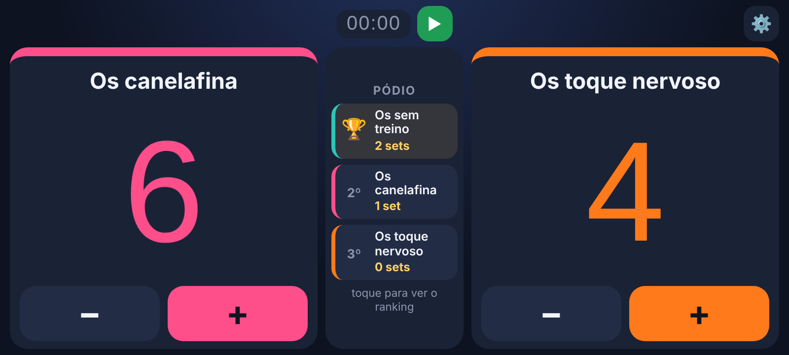
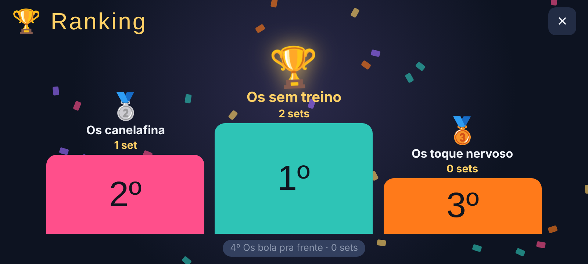

# 🏐 Placar de Vôlei — Quem ganha fica

Aplicativo de placar para partidas de vôlei entre amigos, no esquema **"quem ganha fica"**. Funciona no navegador e pode ser **instalado no celular como app** (PWA), inclusive funcionando sem internet.

🔗 **Acesse:** [placar-volei-lime.vercel.app](https://placar-volei-lime.vercel.app)



## ✨ Funcionalidades

- **Placar com botões + e −** para cada time em quadra
- **De 2 a 4 times**, com nomes editáveis
- **Rodízio automático "quem ganha fica":** ao fechar o set, o vencedor permanece na quadra, o perdedor vai para o fim da fila e o próximo time entra no lugar dele
- **Pontos por set configuráveis**, sempre com **diferença de 2 pontos** (ex.: 14×14 vai até 16×14)
- **Cada time com sua cor** (laranja, verde, roxo e rosa)
- **Pódio ao vivo** no centro da tela com 1º, 2º e 3º lugar por quantidade de sets
- **Tela de ranking** com pódio animado, troféu, medalhas e confetes (toque no pódio para abrir)
- **Cronômetro** da partida com botão play/pause
- **Desfazer** o fim de set em caso de toque errado
- **Dados salvos no aparelho:** se o app fechar, o jogo continua de onde parou
- **Tela travada na horizontal**, sem scroll, pensada para usar na beira da quadra



## 📱 Como instalar no celular

**Android (Chrome):** abra o link → menu **⋮** → **Instalar app**

**iPhone (Safari):** abra o link → botão de **compartilhar** → **Adicionar à Tela de Início**

Depois é só abrir pelo ícone **Placar** na tela inicial.

## 🛠️ Tecnologias

- **HTML, CSS e JavaScript puro** (sem frameworks)
- **PWA:** `manifest.json` + Service Worker (`sw.js`) para instalação e uso offline
- **localStorage** para salvar o estado do jogo
- **Screen Orientation API** para manter o app na horizontal
- Hospedado na **Vercel**

## 📂 Estrutura

```
placar-volei/
├── index.html            # app completo (HTML, CSS e JS)
├── manifest.json         # configurações do app instalável
├── sw.js                 # service worker (cache e modo offline)
├── icon-192.png          # ícones do app
├── icon-512.png
├── icon-maskable-512.png
├── apple-touch-icon.png
└── docs/                 # imagens deste README
```

## ▶️ Rodando localmente

Basta abrir o `index.html` no navegador. Para testar a parte de PWA (instalação e offline), use um servidor local, por exemplo com a extensão **Live Server** do VS Code.

## 👤 Autor

Feito por **Juliano** — [github.com/Julianocodes](https://github.com/Julianocodes)
